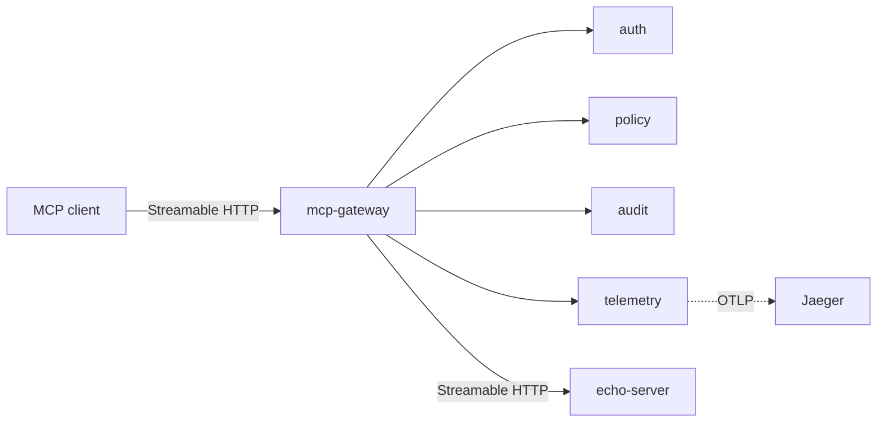

# mcp-gateway

Open-source MCP (Model Context Protocol) gateway. It sits between MCP clients and MCP servers and will add:

- authentication with an API key or a JWT
- a per-client tool allowlist (filter `tools/list`, deny `tools/call`)
- a structured JSON audit log
- OpenTelemetry tracing

**Status: work in progress.** The pass-through proxy and the example MCP server run locally, with Jaeger beside them. Auth, the allowlist, the audit log, and tracing are still stubs. [ADR-001](docs/adr/0001-runtime-e-transporte.md) records the runtime, the transport, and why the gateway terminates sessions instead of relaying them.

The project is shown with a recorded local run. Nothing is hosted.

## Architecture



The client, the gateway, and `echo-server` speak Streamable HTTP today. Auth, policy, audit, and telemetry are the stubs around that path. The gateway mints the session id the client sees; the upstream session id stays inside the process.

## Layout

```text
cmd/mcp-gateway/          entrypoint
internal/proxy/           Streamable HTTP pass-through and its middleware hooks
internal/auth/            API key and JWT, stub
internal/policy/          per-client tool allowlist, stub
internal/audit/           structured JSON audit log, stub
internal/telemetry/       OpenTelemetry exporter, stub
examples/echo-server/     upstream MCP server for tests and the video
docs/adr/                 ADR-001 and the template
```

The interfaces under `internal/` are a sketch so the packages compile and `cmd/mcp-gateway` has a place to wire them. They are not a frozen API.

## Requirements

- Go 1.25 or newer. The module line is `go 1.25.0` because [github.com/modelcontextprotocol/go-sdk](https://github.com/modelcontextprotocol/go-sdk) v1.8.0 requires it.
- Docker, to run the example server and Jaeger.
- [golangci-lint](https://golangci-lint.run/) v2.11.4, for `make lint`.

```bash
go install github.com/golangci/golangci-lint/v2/cmd/golangci-lint@v2.11.4
```

## Run

```bash
docker compose up --build
```

- gateway: `http://127.0.0.1:8080/mcp` (Streamable HTTP), health `http://127.0.0.1:8080/healthz`
- echo-server: `http://127.0.0.1:8081/mcp`, health `http://127.0.0.1:8081/healthz`
- Jaeger UI: `http://127.0.0.1:16686`

The gateway listens on `:8080` and forwards to `http://echo-server:8081/mcp`. Nothing is filtered yet: `tools/list` returns `echo`, `time`, and `delete_everything`.

Without Docker, start the upstream and then the gateway:

```bash
make run-example
make run
```

`make run` reads `MCP_GATEWAY_LISTEN` and `MCP_GATEWAY_UPSTREAM` when the flags are left unset. Flags override the environment. The defaults are `:8080` and `http://127.0.0.1:8081/mcp`.

| Tool | Behavior |
| --- | --- |
| `echo` | returns the text you send |
| `time` | returns the current UTC time in RFC3339 |
| `delete_everything` | marked destructive, and only replies that nothing was deleted |

`delete_everything` is the stand-in a later allowlist demo will block. The pass-through still returns it.

### Call it with curl

Streamable HTTP keeps a session. `initialize` returns `Mcp-Session-Id`; later calls send it back. Responses are `application/json`, which the Streamable HTTP spec allows when the client accepts JSON. This server does not push server-initiated messages, so it does not open an SSE stream.

```bash
curl -sS -D /tmp/mcp-headers http://127.0.0.1:8081/mcp \
  -H 'Content-Type: application/json' \
  -H 'Accept: application/json, text/event-stream' \
  -d '{"jsonrpc":"2.0","id":1,"method":"initialize","params":{"protocolVersion":"2025-11-25","capabilities":{},"clientInfo":{"name":"curl","version":"0"}}}'

SID=$(awk 'tolower($1)=="mcp-session-id:" {print $2}' /tmp/mcp-headers | tr -d '\r')

curl -sS http://127.0.0.1:8081/mcp \
  -H 'Content-Type: application/json' \
  -H 'Accept: application/json, text/event-stream' \
  -H "Mcp-Session-Id: $SID" \
  -d '{"jsonrpc":"2.0","method":"notifications/initialized"}'

curl -sS http://127.0.0.1:8081/mcp \
  -H 'Content-Type: application/json' \
  -H 'Accept: application/json, text/event-stream' \
  -H "Mcp-Session-Id: $SID" \
  -d '{"jsonrpc":"2.0","id":2,"method":"tools/list","params":{}}'

curl -sS http://127.0.0.1:8081/mcp \
  -H 'Content-Type: application/json' \
  -H 'Accept: application/json, text/event-stream' \
  -H "Mcp-Session-Id: $SID" \
  -d '{"jsonrpc":"2.0","id":3,"method":"tools/call","params":{"name":"echo","arguments":{"message":"ping"}}}'
```

The same calls against `http://127.0.0.1:8080/mcp` go through the gateway. The `Mcp-Session-Id` in that response is the gateway's, not the upstream's.

## Tests and lint

```bash
make test    # go test -race ./...
make lint    # golangci-lint v2, including a format check
make build   # writes bin/mcp-gateway and bin/echo-server
```

GitHub Actions runs the same three targets on every push and on pull requests.

## Roadmap

Week 1 milestone: [Semana 1: esqueleto e proxy](https://github.com/EliseuSantos/mcp-gateway/milestone/1).

- [#1](https://github.com/EliseuSantos/mcp-gateway/issues/1) — ADR-001, runtime and transport
- [#2](https://github.com/EliseuSantos/mcp-gateway/issues/2) — repository skeleton, lint, and CI
- [#3](https://github.com/EliseuSantos/mcp-gateway/issues/3) — example MCP server
- [#4](https://github.com/EliseuSantos/mcp-gateway/issues/4) — pass-through proxy and an integration test
- [#5](https://github.com/EliseuSantos/mcp-gateway/issues/5) — learning log and the week-1 diagram

Auth, the allowlist, the audit log, and tracing come next. The proxy already has the middleware hooks they will use.

## License

[Apache-2.0](LICENSE).
