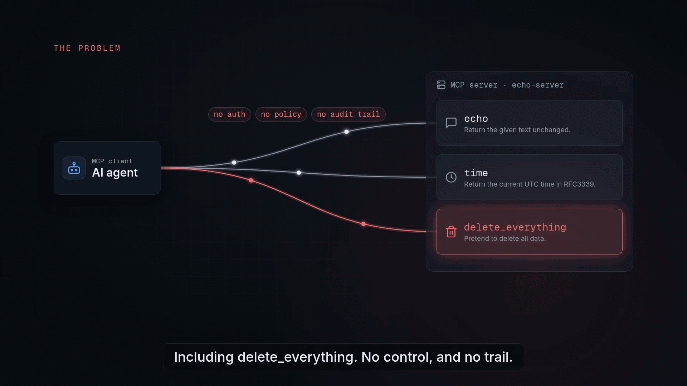
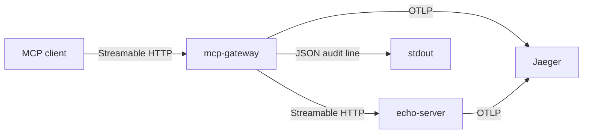
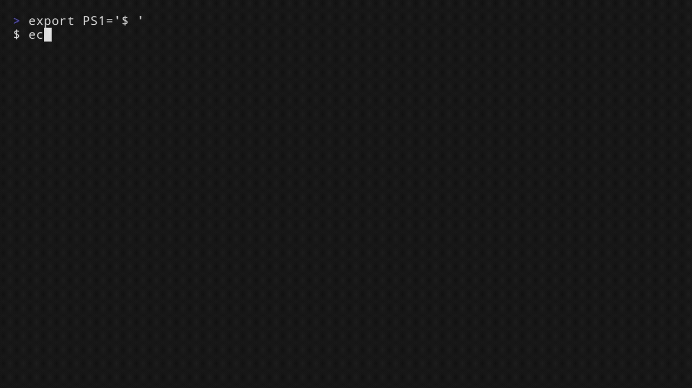

# mcp-gateway

Open-source MCP (Model Context Protocol) gateway. It sits between MCP clients and MCP servers and, in v0.1.0, does four things:

- authenticates each request with an API key or a JWT
- enforces a per-client tool allowlist (filters `tools/list`, denies `tools/call`)
- writes one JSON audit line per call, with argument values redacted unless a field is allowlisted
- exports OpenTelemetry traces to Jaeger

[](docs/media/explainer.mp4)

Watch the 86-second explainer: how the gateway authenticates, enforces the tool allowlist, audits and traces every MCP call.

Square cut: [explainer-square.mp4](docs/media/explainer-square.mp4).

The gateway terminates the client session and opens its own session upstream. [ADR-001](docs/adr/0001-runtime-e-transporte.md) records the transport. [ADR-002](docs/adr/0002-modelo-de-policy.md) records the allowlist. [ADR-003](docs/adr/0003-audit-e-redacao.md) records what the audit line keeps. [docs/learning-log.md](docs/learning-log.md) is the short version of the trade-offs.

## Architecture



Auth and the allowlist run inside the gateway, before a denied `tools/call` is forwarded. The client holds the gateway's session id. The upstream session id stays in the process and is not logged. `GET /metrics` on the gateway is unauthenticated and counts requests by method and decision.

## Quickstart

About five minutes, with Docker and curl installed. The commands assume the repository root. Host ports default to 8080 (gateway), 8081 (echo-server), and 16686 (Jaeger UI). Set `GATEWAY_PORT`, `ECHO_PORT`, or `JAEGER_UI_PORT` when one of those is already taken. OTLP host ports follow `JAEGER_OTLP_GRPC_PORT` (4317) and `JAEGER_OTLP_HTTP_PORT` (4318). The process inside each container keeps its own port.

```bash
docker compose up --build
```

Leave that terminal open. In another terminal:

| URL | What it is |
| --- | --- |
| `http://127.0.0.1:8080/mcp` | gateway, Streamable HTTP |
| `http://127.0.0.1:8080/healthz` | gateway health |
| `http://127.0.0.1:8080/metrics` | request counters |
| `http://127.0.0.1:8081/mcp` | echo-server, no auth |
| `http://127.0.0.1:16686` | Jaeger UI |

Compose mounts [`examples/config/gateway.yaml`](examples/config/gateway.yaml). The `demo` key may call `echo` and `time`. The `admin` key may also call `delete_everything`. Both keys are development values.

[`docs/demo/show.sh`](docs/demo/show.sh) runs the rest of this quickstart and prints the audit line. The calls below are the same steps, written out.

Initialize and keep the session id:

```bash
curl -sS -D /tmp/mcp-headers http://127.0.0.1:8080/mcp \
  -H 'Content-Type: application/json' \
  -H 'Accept: application/json, text/event-stream' \
  -H 'Authorization: Bearer dev-demo-key' \
  -d '{"jsonrpc":"2.0","id":1,"method":"initialize","params":{"protocolVersion":"2025-11-25","capabilities":{},"clientInfo":{"name":"curl","version":"0"}}}'

SID=$(awk 'tolower($1)=="mcp-session-id:" {print $2}' /tmp/mcp-headers | tr -d '\r')

curl -sS http://127.0.0.1:8080/mcp \
  -H 'Content-Type: application/json' \
  -H 'Accept: application/json, text/event-stream' \
  -H 'Authorization: Bearer dev-demo-key' \
  -H "Mcp-Session-Id: $SID" \
  -d '{"jsonrpc":"2.0","method":"notifications/initialized"}'
```

List tools. `delete_everything` is absent:

```bash
curl -sS http://127.0.0.1:8080/mcp \
  -H 'Content-Type: application/json' \
  -H 'Accept: application/json, text/event-stream' \
  -H 'Authorization: Bearer dev-demo-key' \
  -H "Mcp-Session-Id: $SID" \
  -d '{"jsonrpc":"2.0","id":2,"method":"tools/list"}'
```

Call the blocked tool. The HTTP status is 200 and the body is a JSON-RPC error. The upstream is not called.

```bash
curl -sS http://127.0.0.1:8080/mcp \
  -H 'Content-Type: application/json' \
  -H 'Accept: application/json, text/event-stream' \
  -H 'Authorization: Bearer dev-demo-key' \
  -H "Mcp-Session-Id: $SID" \
  -d '{"jsonrpc":"2.0","id":3,"method":"tools/call","params":{"name":"delete_everything","arguments":{"confirm":"yes"}}}'
```

The audit line is on the gateway's stdout. `docker compose logs` mixes it with the text log on stderr. The audit line is the JSON object:

```bash
docker compose logs gateway --no-color --no-log-prefix | grep '"decision":"deny"'
```

A denied call looks like this, with the argument value redacted:

```json
{"client":"demo","method":"tools/call","tool":"delete_everything","decision":"deny","upstream_status":0,"arguments":{"confirm":"[redacted]"}}
```

`GET http://127.0.0.1:8080/metrics` counts that deny. The trace is in Jaeger at <http://127.0.0.1:16686/search?service=mcp-gateway>. The denied call has a gateway span and no echo-server span. An allowed `echo` call has both, on one trace.

A request without a key is HTTP 401. Hitting echo-server on port 8081 directly still returns `delete_everything`; that server has no allowlist.

### Terminal walkthrough

The same local run, recorded in a terminal. Nothing is hosted.



16:9: [docs/demo/demo.mp4](docs/demo/demo.mp4). Square: [docs/demo/demo-square.mp4](docs/demo/demo-square.mp4). Tapes and script: [docs/demo](docs/demo).

## Configuration

Flags, then environment, then the YAML file, then the built-in fallback.

| Flag | Environment | YAML | Fallback |
| --- | --- | --- | --- |
| `-listen` | `MCP_GATEWAY_LISTEN` | `listen` | `:8080` |
| `-upstream` | `MCP_GATEWAY_UPSTREAM` | `upstream` | `http://127.0.0.1:8081/mcp` |
| `-config` | `MCP_GATEWAY_CONFIG` | | empty, which is pass-through |

`OTEL_EXPORTER_OTLP_ENDPOINT` overrides `telemetry.otlp_endpoint`. `OTEL_SERVICE_NAME` overrides `telemetry.service_name`. An empty endpoint means the process serves and does not export traces.

Auth and policy are both set or both absent. One without the other is a startup error. With neither, the gateway is a pass-through and still writes audit lines.

Two example files:

- [`examples/config/gateway.yaml`](examples/config/gateway.yaml) is what Compose mounts. API keys `dev-demo-key` and `dev-admin-key`. `audit.argument_fields` lists `message`, so an `echo` call logs that text and redacts every other argument.
- [`examples/config/jwt.yaml`](examples/config/jwt.yaml) is an HS256 example for a process you start yourself. The client id is the `sub` claim. `exp` is required. `iss` and `aud` are checked because the file sets them. RS256 (a PEM file or a JWKS URL) is the other source; the file comments in `gateway.yaml` show the keys.

Without Docker:

```bash
make run-example   # echo-server on :8081
make run           # gateway on :8080, pass-through, no config file
```

To apply the example allowlist outside Compose:

```bash
go run ./cmd/mcp-gateway -config examples/config/gateway.yaml -upstream http://127.0.0.1:8081/mcp
```

The upstream in that file is the Compose hostname `echo-server`. Override it with `-upstream`, as above.

| Tool | Behavior |
| --- | --- |
| `echo` | returns the text you send |
| `time` | returns the current UTC time in RFC3339 |
| `delete_everything` | marked destructive, and only replies that nothing was deleted |

## Development

- Go 1.25 or newer. The module line is `go 1.25.0` because [github.com/modelcontextprotocol/go-sdk](https://github.com/modelcontextprotocol/go-sdk) v1.8.0 requires it.
- Docker, to run the example server and Jaeger.
- [golangci-lint](https://golangci-lint.run/) v2.11.4, for `make lint`.

```bash
make test    # go test -race ./...
make lint    # golangci-lint v2, including a format check
make build   # writes bin/mcp-gateway and bin/echo-server
```

GitHub Actions runs the same three targets on every push and on pull requests.

The gateway image is [`cmd/mcp-gateway/Dockerfile`](cmd/mcp-gateway/Dockerfile). Release binaries are [`.goreleaser.yaml`](.goreleaser.yaml):

```bash
goreleaser release --clean
```

Run that from a checkout of the `v0.1.0` tag. `main.version` is `dev` unless the linker sets it.

## Layout

```text
cmd/mcp-gateway/          entrypoint and Dockerfile
internal/proxy/           Streamable HTTP proxy and its middleware hooks
internal/auth/            API key and JWT
internal/policy/          per-client tool allowlist
internal/audit/           JSON audit log
internal/telemetry/       OTLP traces and /metrics
internal/config/          YAML loader
examples/echo-server/     upstream MCP server for tests and the video
examples/config/          development auth and allowlist
docs/adr/                 ADR-001, ADR-002, ADR-003
docs/media/               explainer video and cover
docs/demo/                terminal walkthrough, VHS tapes, and script
docs/learning-log.md      decisions and trade-offs
```

## License

[Apache-2.0](LICENSE).
